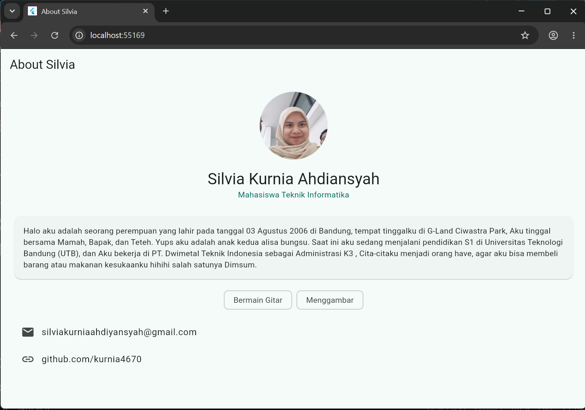

# Tugas Pemrograman Mobile 1 - About Me


## Deskripsi
Sebuah tampilam aplikasi sederhana satu halaman yang berisi foto profil, cerita singkat tentang diri saya, hobi, dan kontak. Dibuat untuk memenuhi tugas mata kuliah Pemrograman Mobile 1.

## Fitur
- Foto profil dan tagline
- Cerita singkat tentang saya
- Daftar hobi dalam bentuk chip
- Kontak email dan GitHub

## Screenshot


## Teknologi
- Flutter
- Dart
- Material Design 3

## Cara Menjalankan
1. Pastikan Flutter sudah terpasang
2. Clone repository ini
3. Jalankan perintah berikut:

```
flutter pub get
flutter run -d chrome
```

## Dibuat oleh
- Nama: Silvia Kurnia Ahdiansyah
- NIM: [24552011151]
- Kelas: [TIF 24 A RM]
